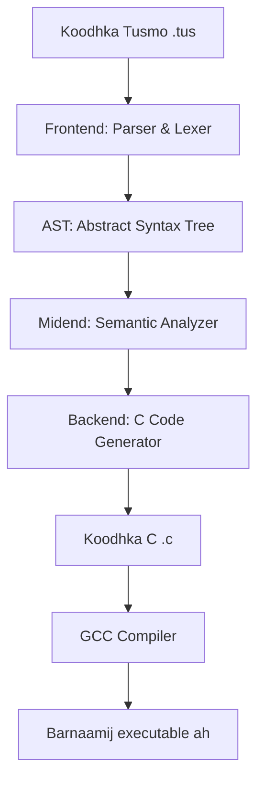

# Agabka & Deegaanka (Tooling & Ecosystem)

Luuqad kasta oo casri ah waxaa guusheeda go'aamiya agabka ku xeeran (ecosystem). Tusmo waxay la timaadaa agab dhammaystiran oo loogu talagalay horumariyaha, oo ay ku jirto taageerada tifaftirayaasha koodhka sida **VS Code**.

---

## Editor Support: Fidinta VS Code (Extension)

Waxaan u dhisnay fidin (extension) rasmi ah oo loogu talagalay **Visual Studio Code** si aad u hesho deegaan horumarineed oo heer sare ah. Fidintu waxay ku jirtaa galka `Extension/` ee ku dhex jira mashruuca rasmiga ah ee Tusmo.

### Astaamaha Fidinta (Features):
1. **Midabaynta Naxwaha (Syntax Highlighting)**: Wuxuu midabeeyaa erayada muhiimka ah (`keyd`, `qeex`, `hawl`, `koox`, `haddii`, iwm), lambarada, qoraalka, iyo faallooyinka. Tani waxay ku salaysan tahay qaabka caalamiga ah ee TextMate (`Extension/syntaxes/tusmo.tmLanguage.json`).
2. **Language Server Protocol (LSP)**: Fidintu waxay bilowdaa server LSP ah oo ku qoran Python (`Extension/server/tusmo_hover_server.py`). LSP server-ku wuxuu bixiyaa:
   - **Hover Information**: Markaad dul istaagto shaqo (method) ama keyd gaar ah, wuxuu ku tusi doonaa sharraxaadda, nooca xogta, iyo wixii docstring ah oo ku lifaaqan.
   - **Diagnostics (Red Squiggles)**: Wuxuu koodhkaaga ka baarayaa khaladaadka naxwaha iyo semantic-ka isagoo si toos ah hoosta uga xariiqaya khadka cas ee cilada (error squiggles) adigoon weli compile-gareyn!
   - **Symbol Outline**: Outline taageero leh oo ku tusaysa liiska classes-ka, structs-ka, iyo hawlaha faylka ku qoran.

### Sida loogu rakibo VS Code-kaaga:
Si aad u tijaabiso ama u isticmaasho fidinta adiga oo horumarinaya koodhka:
1. Nuqul (copy) ama u samee symbolic link galka `Extension/` ee ku dhex jira folder-ka fidinta ee VS Code:
   - **Linux/macOS**:
     ```bash
     ln -s /home/mubaarak/Desktop/Tusmo/Extension ~/.vscode/extensions/tusmo-extension
     ```
   - **Windows (PowerShell)**:
     ```powershell
     New-Item -ItemType SymbolicLink -Path "$Home\.vscode\extensions\tusmo-extension" -Value "C:\Waddada\Tusmo\Extension"
     ```
2. Dib u kici (restart) VS Code-kaaga. Markaad furto fayl ku dhammaada `.tus`, waxaad arki doontaa midabaynta koodhka oo shaqaynaysa iyo LSP-ga oo si toos ah u hawlgelaya!

---

## Adeegsiga Compiler-ka CLI-ga

Barnaamijka laf-dhabarta u ah compiler-ka Tusmo wuxuu ku dhex jiraa `tusmo.py`. Markaad CLI-ga ka socodsiinayso, waxaad haysataa fursado kala duwan:

### 1. Socodsiin Fudud (Compile & Run)
```bash
python tusmo.py magaca_faylka.tus
```
Tani waxay si toos ah u dhalinaysaa faylka `.c`, waxay u compile-garaynaysaa executable, wayna ordi doontaa.

### 2. compilation-ka optimizes-ka ugu sarreeya (Production Build)
Sida caadiga ah, compiler-ku wuxuu wacaa GCC isagoo isticmaalaya optimizations heerkoodu sarreeyo si barnaamijku u noqdo mid aad u dheereeya:
```bash
gcc -O3 -march=native -flto -Wall -Wextra -Werror -Wno-unused-parameter
```
Astaamahani waxay hubinayaan in koodhka la dhaliyay uu yahay midka ugu badbaadada badan, uguna xawaaraha dheereeya nidaamkaaga (CPU architecture optimize).

### 3. Dhoofinta Executable Gaar ah (-o)
Haddii aad rabto inaad soo saarto binary la ordi karo oo aad dadka kale u diri karto:
```bash
python tusmo.py bouncingBall.tus -o bouncingBall
```
Kanu wuxuu dhalinayaa executable lagu magacaabo `bouncingBall` oo ku habboon nidaamkaaga.

---

## Hannaanka Gudaha ee Compiler-ka (Under the Hood)

Compiler-ka Tusmo wuxuu u shaqeeyaa saddex heer oo waaweyn:



1. **Frontend**: Wuxuu u kala jebiyaa koodhka tokens, ka dibna wuxuu u rogaa geed naxweheed ah oo loo yaqaan **AST (Abstract Syntax Tree)**.
2. **Midend (Semantic Checker)**: Heerkani waa halka badbaadadu ka dhacdo. Wuxuu hubiyaa in dhammaan keydiyaasha (`keyd`) la qeexay ka hor intaan la isticmaalin, in noocyada xogtu ay sax yihiin (Type checking), iyo in memory ownership-ku uu nabad qabo.
3. **Backend**: Wuxuu AST-ga u beddelaa kood C ah oo aad u nadiif ah oo ay weheliso maktabadda runtime-ka (`runtime/tusmo_runtime.h`), ka dibna wuxuu wacaa GCC.

Hadda waxaad baratay agabka ku xeeran Tusmo! U gudub bogga u dambeeya ee **Ka Qaybqaadashada** si aad u aragto FAQ-yada iyo sida aad gacan uga geysan karto horumarinta luuqaddan.
